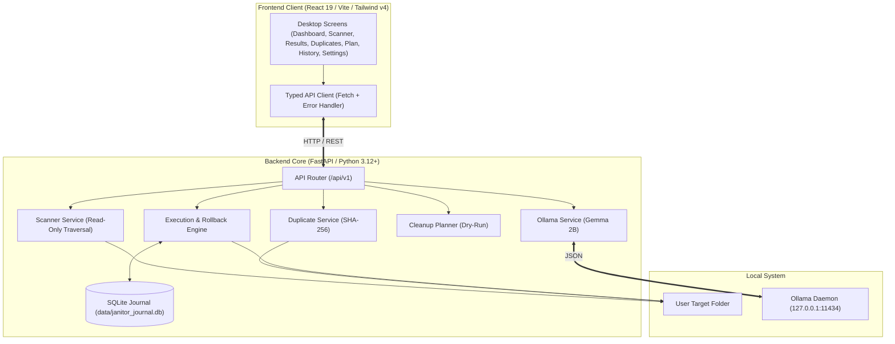
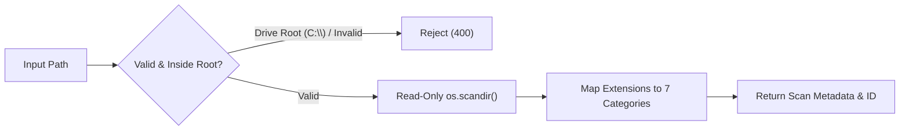
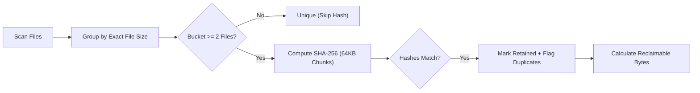
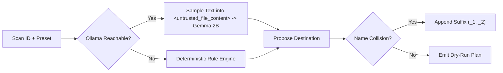
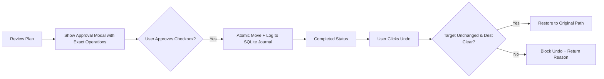

# 🧹 Project Janitor

> **Deterministic, Privacy-First Desktop Storage Organizer & Duplicate Manager with Local AI for Windows.**

[](https://fastapi.tiangolo.com)
[](https://react.dev)
[](https://www.typescriptlang.org)
[](https://tailwindcss.com)
[](https://vitejs.dev)
[](https://ollama.com)
[](#security--safety-invariants)

---

## Overview

**Project Janitor** is an offline system utility for Windows that analyzes messy directories, detects exact byte-for-byte duplicates using cryptographic SHA-256 hashes, generates dry-run cleanup plans with optional local Google Gemma 2B AI, and executes file moves with an explicit review step and reversible SQLite rollback.

- **100% Local**: No cloud subscriptions, no telemetry, and zero paid API keys.
- **Non-Destructive**: Never deletes files automatically. Duplicates are flagged for manual review.
- **Transactional Rollback**: Every move/rename is recorded in a local SQLite journal (`data/janitor_journal.db`).
- **Offline AI Fallback**: Runs with local Gemma 2B via Ollama. Falls back to deterministic rules if offline.

---

## Core Capabilities

| Capability | Method | Key Benefit |
| :--- | :--- | :--- |
| **Recursive Scanner** | Non-blocking, read-only `os.scandir` with path containment | Categorizes into 7 types; blocks drive roots (`C:\`, `D:\`) |
| **Exact Duplicate Engine** | Size bucket pre-filtering + chunked SHA-256 hashing | Bit-for-bit accuracy; calculates conservative reclaimable space |
| **Local AI Classification** | Local Google Gemma 2B via Ollama (`format: json`) | Context-aware categorization without data egress |
| **Dry-Run Planner** | Presets (`Category`, `Date`, `Flat`) with collision suffixing | Preview all operations before any files move |
| **Explicit Approval** | Interactive dialog with exact operation manifest & checkbox | Prevents accidental modifications |
| **Safe Reversible Undo** | SQLite transactional log with on-disk pre-validation | 1-click restore for single operations or full plans |

---

## System Architecture



---

## Workflows

### 1. Safe Scanning & Path Containment



### 2. Multi-Stage Exact Duplicate Detection



### 3. Dry-Run Planning & Local AI Classification



### 4. Explicit Approval & Transactional Undo



---

## Quickstart

### 1. Backend (FastAPI)
```powershell
cd backend
py -m venv .venv
.\.venv\Scripts\Activate.ps1
pip install -r requirements.txt
cp .env.example .env
.\.venv\Scripts\python.exe -m uvicorn app.main:app --host 127.0.0.1 --port 8000 --reload
```
- **API Base**: `http://127.0.0.1:8000`
- **Swagger Docs**: `http://127.0.0.1:8000/api/v1/docs`

### 2. Frontend (React / Vite)
```powershell
cd frontend
npm install
npm run dev
```
- **App URL**: `http://localhost:5173`

### 3. Local AI (Optional)
Install [Ollama for Windows](https://ollama.com/download/windows), then in terminal:
```powershell
ollama pull gemma:2b
ollama serve
```

---

## API Summary

| Endpoint | Method | Purpose |
| :--- | :--- | :--- |
| `/health` | `GET` | Service & environment health |
| `/api/v1/scan` | `POST` | Start recursive directory scan |
| `/api/v1/scan/{id}` | `GET` | Paginated scan results & category totals |
| `/api/v1/duplicates` | `POST` | Run SHA-256 duplicate detection |
| `/api/v1/ai/status` | `GET` | Check Ollama reachability & configured model |
| `/api/v1/plans` | `POST` | Generate dry-run organization plan |
| `/api/v1/operations/execute` | `POST` | Execute approved plan (`confirm_approval: true`) |
| `/api/v1/operations` | `GET` | Query SQLite operation audit journal |
| `/api/v1/operations/{id}/undo` | `POST` | Revert a completed operation safely |
| `/api/v1/operations/undo-plan/{id}` | `POST` | Revert all eligible operations in a plan |

---

## Security & Safety Invariants

- **Root Sandboxing**: Traversal locked strictly within the selected target directory. System drive roots (`C:\`, `D:\`) are blocked.
- **Non-Destructive**: Redundant files are flagged (`DUPLICATE_FLAG`) for user review—never auto-purged.
- **Collision Protection**: Automatically suffixes colliding destination filenames (`_1`, `_2`).
- **Prompt Sandboxing**: File excerpts are wrapped in `<untrusted_file_content>` tags; only text formats are sampled (max 1,500 chars).
- **Pre-Rollback Check**: Validates that destination files exist and source locations are free before reversing.
- **Zero Cloud Egress**: Fully local execution; no telemetry or remote calls.

---

## Testing & Quality Assurance

```powershell
# Run backend tests (57 passed, 2 skipped, 0 failed)
cd backend; .\.venv\Scripts\pytest -v

# Run frontend tests (20 passed, 0 failed)
cd frontend; npm test

# Frontend typecheck & production build (0 errors)
cd frontend; npm run build
```

---

## Known Limitations

1. **Drive Roots Blocked**: Whole drives (`C:\`, `D:\`) cannot be scanned to prevent OS instability.
2. **External Symlinks**: Symlinks pointing outside the target directory are skipped.
3. **External Modifications Block Undo**: If a file is altered externally after execution, rollback is blocked to prevent data corruption.
4. **VRAM Ceiling**: Models larger than `gemma:2b` (e.g. 7B/9B) exceed 4 GB VRAM on entry-level GPUs like RTX 3050 and should be avoided.

---

## License

MIT License. 100% Free and Open Source.
