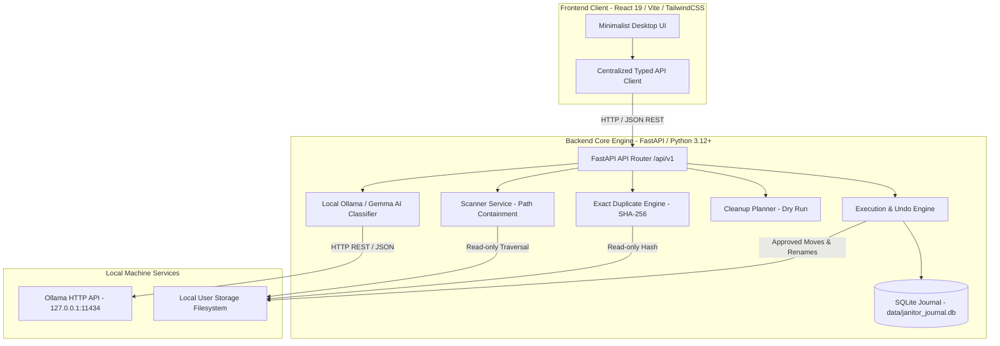

# Project Janitor: Architecture & System Design

## 1. Architectural Overview & System Decomposition

Project Janitor is designed with a strict client-server decoupling to separate user interface presentation from deterministic filesystem operations and operating system interactions.

---

## 2. Frontend and Backend Responsibilities

### Frontend Responsibilities (`frontend/`)
- **Single Page Application (SPA)**: Built using React 19, TypeScript, Vite, and Tailwind CSS v4.
- **Strict Read-Only Display**: Visualizes data retrieved through structured backend APIs. Never invents state or executes filesystem commands.
- **Explicit Confirmation Interlocks**: Demands affirmative user review of exact operation manifests (`source → destination`) before any mutating request is dispatched.
- **Error & Status Presentation**: Renders loading spinners, error messages, empty states, and live service health indicators without silent fallbacks.

### Backend Responsibilities (`backend/`)
- **Filesystem Traversal & Path Safety**: Validates all client paths, prevents traversal beyond authorized scan roots, and rejects OS drive roots.
- **Cryptographic Duplicate Detection**: Groups files by byte size before computing SHA-256 hashes to guarantee content identity.
- **Deterministic Cleanup Planning**: Generates proposed file organization manifests using rule heuristics and optional local AI classification. Operates 100% dry-run.
- **Explicit Execution & Transactional Rollback**: Executes only approved file moves/renames, logs transactions to an isolated SQLite journal, and verifies integrity before undo.
- **Zero Cloud Footprint**: Operates entirely offline without cloud databases, analytics, telemetry, or paid external APIs.

---

## 3. API Communication & Contracts

The frontend communicates with the backend exclusively via HTTP/1.1 REST endpoints over JSON:

- **Base URL**: `http://127.0.0.1:8000` (Configurable via `VITE_API_BASE_URL`).
- **CORS Policy**: Restricted to local origins (`http://localhost:5173`, `http://127.0.0.1:5173`).
- **Core Endpoints**:
  - `GET /health`: Health and service availability verification.
  - `POST /api/v1/scan`: Initiates a recursive folder scan within an authorized target directory.
  - `GET /api/v1/scan/{scan_id}`: Retrieves paginated file metadata and category distributions.
  - `POST /api/v1/duplicates`: Computes exact SHA-256 duplicate sets and reclaimable volumes.
  - `GET /api/v1/duplicates/{scan_id}`: Retrieves cached duplicate analysis for a completed scan.
  - `GET /api/v1/ai/status`: Reports Ollama reachability and configured model (`gemma:2b`) availability.
  - `POST /api/v1/ai/classify`: Classifies an individual file using Gemma structured JSON output.
  - `POST /api/v1/plans`: Generates a dry-run cleanup plan with proposed moves and duplicate flags.
  - `GET /api/v1/plans/{plan_id}`: Retrieves an existing cleanup plan manifest.
  - `POST /api/v1/operations/execute`: Executes an explicitly approved cleanup plan.
  - `GET /api/v1/operations`: Queries the SQLite journal for executed operations.
  - `GET /api/v1/operations/{operation_id}`: Retrieves detailed audit information for a single operation.
  - `POST /api/v1/operations/{operation_id}/undo`: Reverts an eligible completed operation.
  - `POST /api/v1/operations/undo-plan/{plan_id}`: Reverts all eligible operations belonging to a plan.

---

## 4. Subsystem Deep Dives

### Scanner Service (`backend/app/services/scanner.py`)
- **Path Containment & Security**:
  - Resolves target paths to canonical absolute paths (`os.path.realpath`).
  - Prohibits system drive roots (e.g. `C:\`, `D:\`) and critical system directories (`C:\Windows`, `C:\Program Files`).
  - Ignores or flags symbolic links pointing outside the authorized scan root.
  - Gracefully skips inaccessible or permission-restricted folders and files.
- **Deterministic Categorization**:
  - Categorizes files into 7 standard categories (`documents`, `images`, `videos`, `audio`, `archives`, `code`, `other`) based on verified extension maps.
- **Non-Mutation Invariant**:
  - Uses `os.scandir` exclusively in read-only mode. Never modifies, moves, creates, or deletes any files during scanning.

### Exact Duplicate Detection (`backend/app/services/duplicates.py`)
- **Multi-Stage Size-Bucket Hashing**:
  1. Filters out files with unique byte sizes (files with distinct sizes cannot be duplicates).
  2. For candidate files sharing identical byte sizes, reads and computes cryptographic SHA-256 hashes in 64 KB chunks.
  3. Detects if file size or modification time changes during hashing and flags or skips them.
- **Reclaimable Space Calculation**:
  - Identifies one file per group as the canonical retained copy.
  - Calculates reclaimable bytes conservatively: `reclaimable_bytes = (file_count - 1) * file_size`.
- **Zero AI Dependency**:
  - Exact duplicates are verified strictly by cryptographic byte comparison, never by heuristic or AI guessing.

### Local Ollama & Gemma Integration (`backend/app/services/ollama.py`)
- **Offline Daemon Protocol**:
  - Connects to Ollama's local HTTP API at `http://127.0.0.1:11434` with zero cloud connectivity.
  - Configured for `gemma:2b` (1.7 GB VRAM footprint, optimal for 4 GB GPUs like RTX 3050).
- **Prompt Injection Defense & Sandboxing**:
  - Excerpts up to 1,500 characters of text from text-only file formats. Binary files are classified strictly by metadata.
  - File text is encapsulated in `<untrusted_file_content>` isolation wrappers.
- **Structured JSON Output**:
  - Calls Ollama with `format: "json"` and `temperature: 0.0`.
  - Enforces Pydantic validation: rejects unexpected categories, confidence values `< 0.0` or `> 1.0`, or malformed JSON payloads.
  - Seamlessly falls back to deterministic rule heuristics if Ollama is unreachable.

### Cleanup Plan Generation (`backend/app/services/planner.py`)
- **Dry-Run Planning**:
  - Accepts user organization preferences (`category`, `date`, `flat`).
  - Supports proposed `MOVE`, `RENAME`, `MOVE_AND_RENAME`, `SKIP`, and `DUPLICATE_FLAG` actions.
  - Proposes destinations strictly within the authorized scan root directory.
- **Collision Avoidance**:
  - Checks proposed destination paths against existing files on disk and other planned destinations in the manifest.
  - Automatically appends numeric suffixes (`_1`, `_2`) to prevent overwriting existing files.
- **Manual Duplicate Flagging**:
  - Duplicate files are flagged for manual review with action `DUPLICATE_FLAG`. Redundant files are never automatically scheduled for deletion.

### Execution Engine & Transactional Undo (`backend/app/services/executor.py`)
- **Approval Precondition**:
  - Rejects execution unless the client payload provides `{ confirm_approval: true }` and matching `plan_id`.
  - Re-evaluates on-disk conditions immediately before executing: if source files have been altered or destination paths have become occupied, the plan is rejected as stale.
- **Safe Execution**:
  - Performs atomic moves using `shutil.move` and `os.replace`.
  - Creates necessary parent directories deterministically.
- **SQLite Operation Journal (`data/janitor_journal.db`)**:
  - Records every transaction: `operation_id`, `plan_id`, `original_path`, `destination_path`, `operation_type`, `file_hash`, `file_size_bytes`, `status`, `undo_status`, and `timestamp`.
- **Reversible Undo**:
  - An operation is undo-eligible only when its recorded status is `completed` and `undo_status` is `reversible`.
  - Revalidates that the moved file exists at its destination and that the original path is currently unoccupied. If either condition fails, undo is blocked and the explicit reason is returned.

---

## 5. Security & Safety Invariants

1. **Root Directory Sandboxing**: All scanned, planned, and executed paths must resolve strictly within the explicitly authorized scan root.
2. **Drive Root Protection**: System drive roots (`C:\`, `D:\`) are strictly rejected.
3. **Non-Destructive Guarantee**: Project Janitor never permanently deletes user files. Duplicate files are flagged for manual user inspection only.
4. **Collision Immunity**: Destructive file overwrites are prohibited by pre-flight validation and collision suffixing.
5. **Isolated SQLite Journal**: The operations journal is stored in the local application `data/` directory outside user folders and excluded from version control.
6. **No Cloud Egress**: The application does not communicate with any external servers or telemetry collectors.
