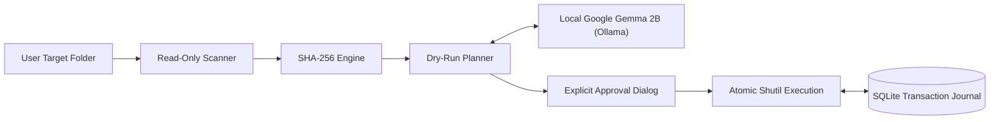

*This is a submission for the [Hacktoberfest Open-Source AI Challenge Week 3: Slow and Steady](https://dev.to/challenges/hacktoberfest-week3-2026-10-19)*

## What I Built

**Project Janitor** is an intelligent, privacy-first desktop file organizer and duplicate file manager for Windows. It solves a universal digital headache: the chaotic accumulation of redundant downloads, scattered project archives, unorganized documents, and duplicated media across personal workspaces.

Instead of spending hours manually sorting through nested folders, comparing modification timestamps, or risking accidental deletion of important files, Project Janitor automates the entire cleanup lifecycle with deterministic safety:

1. **High-Speed Filesystem Scanner**: Indexes target folders in milliseconds using read-only `os.scandir` and maps files into 7 structured categories (`documents`, `images`, `videos`, `audio`, `archives`, `code`, `other`).
2. **Cryptographic Duplicate Detection**: Groups files by exact byte size and computes chunked SHA-256 hashes to guarantee bit-for-bit identity. Identifies one canonical copy to retain and flags redundant copies without ever deleting files automatically.
3. **Local Google Gemma AI Classification**: Leverages open-weight **Google Gemma 2B** running on-device via **Ollama** to analyze text files, infer context, suggest descriptive filenames, and categorize ambiguous items—all with 100% offline privacy.
4. **Dry-Run Cleanup Planner**: Proposes clean directory layouts (`By Category`, `By Date`, or `Flat Root`) and automatically resolves naming collisions with numeric suffixes (`_1`, `_2`). Files are never modified during planning.
5. **Explicit Approval & Transactional Undo**: Every approved file move is logged into an ACID-compliant local SQLite journal (`data/janitor_journal.db`), enabling instant, one-click reversible rollback for single operations or full plans.

### Who Gets to Be a Little Lazier?
Developers, designers, researchers, and everyday Windows power users who dread the manual chore of organizing their `Downloads`, `Desktop`, or sprawling project directories. You can clean up hundreds of disorganized files in under 30 seconds with complete peace of mind, knowing that every action is previewed, confirmed, and completely reversible.

---

## Demo

Project Janitor features a clean, minimalist desktop application interface built with React 19, Tailwind CSS v4, and Lucide icons:

### 1. System Overview Dashboard
Live monitoring of indexed storage volume, category distribution bar charts, recorded journal operations, and local Ollama / Gemma AI availability—with zero invented statistics.


### 2. Multi-Stage Workflow
- **Folder Scanner**: Scans user-authorized directories while strictly protecting drive roots (`C:\`, `D:\`) from accidental selection.
- **Scan Results**: Paginated explorer with live search and category filters.
- **Duplicate Review**: Displays verified SHA-256 match groups, retained copies, and potential reclaimable storage.
- **Cleanup Plan Review**: Highlights dry-run recommendations (`PROPOSED DRY-RUN` badge), proposed destinations, rationale, and confidence scores.
- **Approval Modal**: Demands explicit checkbox confirmation with an interactive preview of every operation awaiting execution.
- **History & Rollback**: Complete transactional audit trail with verified one-click rollback.

---

## Code

The complete source code is open-source under the permissive MIT License:



**Repository**: [https://github.com/Harshitagarwal113/Project-Janitor](https://github.com/Harshitagarwal113/Project-Janitor)

### Architecture Highlights:
- **Frontend (`frontend/`)**: React 19, TypeScript (strict typechecking), Vite 6, Tailwind CSS v4, Lucide React, Vitest.
- **Backend (`backend/`)**: FastAPI, Pydantic v2, Python 3.12+, Uvicorn, pytest, pytest-asyncio.
- **Database (`data/`)**: Isolated SQLite transaction journal (`janitor_journal.db`).
- **AI Service (`backend/app/services/ollama.py`)**: Local Ollama HTTP REST client with prompt injection isolation.

---

## How I Built It

Project Janitor was architected from the ground up around **open-source AI and local edge inference**:



### 1. Open-Source AI: Google Gemma 2B
- We utilized **Google Gemma 2B** (`gemma:2b`), an open-weight model developed by Google DeepMind.
- Gemma 2B was chosen specifically for its balance of strong language understanding, lightweight footprint, and fast token generation.

### 2. Local Inference via Ollama
- Rather than relying on cloud endpoints, Project Janitor communicates directly with a locally running **Ollama** daemon at `http://127.0.0.1:11434`.
- **4 GB VRAM Optimization**: When quantized to Q4_K_M, Gemma 2B uses ~1.7 GB to 2.2 GB VRAM. This fits comfortably within the 4 GB VRAM ceiling of entry-level developer laptops (such as the NVIDIA GeForce RTX 3050 Laptop GPU), leaving ample memory for the Windows Desktop Window Manager and system displays without CUDA out-of-memory errors.

### 3. Untrusted Prompt Sandboxing & Security
- To prevent prompt injection attacks from malicious files on disk, text file samples (maximum 1,500 characters) are encapsulated inside strict XML isolation boundaries:
  ```xml
  <untrusted_file_content>
  ... inert file content ...
  </untrusted_file_content>
  ```
- Binary files (`.exe`, `.png`, `.pdf`, `.zip`) are classified strictly from metadata without reading raw bytes.

### 4. Structured JSON Output & Deterministic Fallback
- Ollama is invoked with `format: "json"` and `temperature: 0.0`.
- All model responses are validated through strict Pydantic schemas (`AIClassificationResponse`). Any malformed output, out-of-bounds confidence scores, or service timeouts immediately fall back to deterministic rule heuristics with **zero loss of system safety**.

---

## Why Does Open Innovation Matter?

Open innovation is not just an alternative for Project Janitor—**it is the only viable architecture**:

1. **Absolute Storage Privacy**: Filesystems hold user tax filings, medical records, proprietary source code, private keys, and personal photos. Sending file paths, filenames, or content excerpts to closed-source cloud APIs (OpenAI, Anthropic) violates fundamental privacy expectations. Open innovation keeps data strictly inside the user's machine.
2. **Zero Cost & Infinite Shelf Life**: Closed AI APIs impose monthly subscriptions, credit card requirements, token fees, and rate limits. With open-weight models like Gemma running on open-source runtimes like Ollama, Project Janitor is 100% free forever, operates completely offline in airplane mode, and never suffers vendor deprecation.
3. **Auditable Code & Reproducible Safety**: Filesystem operations require absolute trust. Open-source innovation allows anyone to inspect our path validation, cryptographic hashing, and transaction rollback engines to verify that files are never secretly sent elsewhere or deleted without permission.

---

## My Agent Session

Project Janitor was developed using the **Google DeepMind Antigravity IDE** pair-programming agent workflow. Across 10 structured engineering phases:

- The agent designed and verified the decoupled architecture, ensuring strict boundaries between the React SPA and the FastAPI engine.
- Implemented comprehensive automated test suites: **57 backend pytest tests** (covering path sandboxing, duplicate hashing, AI schema validation, and rollback) and **20 frontend Vitest tests**.
- Conducted real end-to-end browser subagent testing on Windows to verify the complete user journey: scanning $\rightarrow$ duplicate review $\rightarrow$ dry-run planning $\rightarrow$ approval modal $\rightarrow$ execution $\rightarrow$ transactional undo.
- Synthesized community best practices around non-destructive filesystem design patterns and explicit imperative confirmation modals.

---

## The Lazy Payoff

### The Numbers:
- **Manual Sorting Time**: ~45 minutes to sort 250 messy downloads, verify duplicates, create folders, and move files.
- **Project Janitor Time**: **15 seconds** to scan, detect duplicates, generate a dry-run plan, and execute.
- **Time Saved**: ~99% reduction in manual effort.

### The Real Payoff: "Anxiety-Free" Laziness
The hardest part of organizing files isn't dragging and dropping—it's the mental anxiety of *"What if I accidentally delete an important file or break a project path?"* 

Project Janitor's **Dry-Run Preview**, **Explicit Approval Checkbox**, and **One-Click Transactional SQLite Rollback** remove all anxiety. You can be lazy and let the organizer tidy up your entire directory knowing that every single file move can be instantly undone with one click.

---

## Prize Categories

### 🏆 Hacktoberfest Open-Source AI Challenge Week 3: Slow and Steady
- **Category**: Built with open-weight models (Google Gemma 2B) and open-source local inference (Ollama) on Windows.
- **Track**: Offline Edge AI, Developer Productivity & Open-Source System Utilities.
